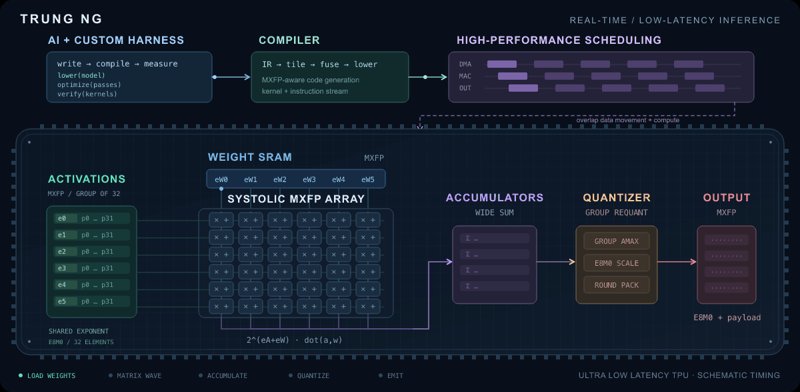

  

<a href="assets/ultra-low-latency-tpu.svg">Static view</a>

### Tech Lead · 6G AI ASIC · Hardware-software co-design

I work at the intersection of **machine learning, AI accelerators, and software systems**. My background is in probabilistic deep learning and digital signal processing, with research across speech, images, text, and single-cell biology.

I use **AI with custom harnesses** for **compiler development and high-performance scheduling**, with a focus on **MXFP shared group exponents** and **real-time, low-latency inference**.

Alongside my 6G AI ASIC work, I build open-source tools for **AI-assisted engineering**: coding-agent integrations, developer workflows, and model inspection tools. I care about clear interfaces, measured performance, and understanding what actually works.

🇫🇮 Finland · 🇻🇳 Vietnam &nbsp; | &nbsp; [LinkedIn](https://www.linkedin.com/in/trungnt13/) · [X](https://x.com/trungnt13)

## What I'm building

| Project | Focus |
| :--- | :--- |
| **[ASM](https://github.com/trungnt13/asm)** | My personal fork of OpenAI Codex for local coding-agent workflows. |
| **[Codex subagents for Claude Code](https://github.com/trungnt13/claude-codex-subagents)** | OpenAI models through the Codex CLI as native Claude Code subagents. |
| **[System1 Thinking](https://github.com/trungnt13/claude-system1)** | Adaptive reasoning-effort selection for Claude Code. |
| **[AI Colab](https://github.com/trungnt13/ai-colab)** | Compact VS Code metrics and diagnostic context for AI-assisted development. |
| **[netron-rs](https://github.com/trungnt13/netron-rs)** | An early Rust toolkit for parsing, querying, and laying out neural-network model graphs. |
| **[codex-acp](https://github.com/trungnt13/codex-acp)** | A Codex plugin and Rust daemon for working with Agent Client Protocol (ACP) coding agents, including Cursor and Copilot. |

**Tools I work with:** Python · Rust · TypeScript · PyTorch · TensorFlow

## Research foundations

- **[ODIN](https://github.com/trungnt13/odin-ai)**: probabilistic deep learning, variational autoencoders, and representation learning.
- **[SISUA](https://github.com/trungnt13/sisua)**: semi-supervised generative models for single-cell data.
- **[bigarray](https://github.com/trungnt13/bigarray)**: memory-mapped NumPy arrays for scalable data access and multiprocessing.
- **[Covid-Cough-Detection](https://github.com/trungnt13/Covid-Cough-Detection)**: research on transformers and self-supervised learning for cough-audio classification.

<strong>Teaching and workshops</strong>

I have shared practical material on machine learning, speech processing, and Bayesian inference through University of Eastern Finland courses and workshops.

- UEF summer schools: [2016](https://github.com/trungnt13/uef-summerschool2016) · [2017](https://github.com/trungnt13/uef-summerschool2017)
- [Speech processing workshop (2017)](https://github.com/trungnt13/uef-speechworkshop2017) · [Sequence learning workshop (2018)](https://github.com/trungnt13/uef-seqworkshop2018)
- [Bayesian inference (2017)](https://github.com/trungnt13/BAY2-uef17): PyMC and Edward.
- [Python for Computational Intelligence (2017)](https://drive.google.com/drive/folders/1owFx4cLxXv_FTOlgBQ2t-emsG_04a-Uf?usp=sharing)
- [Deep learning course (2019)](https://drive.google.com/drive/folders/17SDBkIue6QTlhiBKiuQ25zZTiHewL6g-?usp=sharing): seven assignments and three mini-projects.

<strong>Side projects and life outside code</strong>

- **[Neural wedding card](https://github.com/trungnt13/neural-wedding-card)**: neural style transfer for my wedding-card design.
- **[VeriQA-bot](https://github.com/trungnt13/VeriQA-bot)**: an after-dinner experiment in answering questions from Veri's blog content.
- **[VSCode Autoflake](https://github.com/trungnt13/vscode-autoflake)**: remove unused Python imports and variables.
- **[Coconerd](https://github.com/trungnt13/Code-counts)**: code counts for nerds.
- **[Brick racing](https://play.google.com/store/apps/details?id=com.trunganh.superbrickracing)**: an Android take on the classic game.

Outside engineering: climbing, mountaineering books, and the history of science.

---

**Let's connect:** [LinkedIn](https://www.linkedin.com/in/trungnt13/) · [X](https://x.com/trungnt13)

Personal projects and opinions, not an employer statement.
